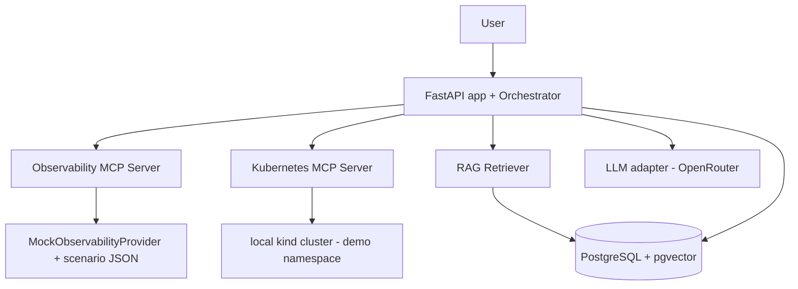
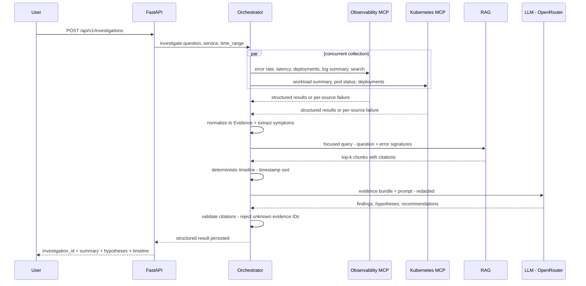

# Incident Investigator v1 — Implementation Plan

**Source spec:** `incident-investigator-v1-focused-spec (1).md`
**Workspace:** `e:/rootlens` — project will live in `e:/rootlens/incident-investigator/`

---

## 1. Locked Technology Decisions

| Concern | Choice | Rationale |
|---|---|---|
| LLM synthesis | **OpenRouter** (OpenAI-compatible API) | User has an OpenRouter key only; one key, cheap models |
| Default synthesis model | `openai/gpt-4o-mini` via OpenRouter | Cheap, reliable JSON output; swappable via env var |
| Embeddings | **Local `sentence-transformers` `all-MiniLM-L6-v2`** (384-dim) | Zero API cost, offline, pgvector handles 384-dim fine |
| Vector store | PostgreSQL + `pgvector` | Per spec |
| API | FastAPI + Pydantic v2 | Per spec |
| ORM / migrations | SQLAlchemy 2.0 + Alembic | Per spec |
| MCP | Official MCP Python SDK (stdio servers) | Per spec |
| Kubernetes | official `kubernetes` Python client against local `kind` | Per spec |
| Runtime | Docker Compose (app + postgres) + `kind` for demo workload | Per spec |
| Tests | pytest | Per spec |

**Env vars** (`.env.example`): `OPENROUTER_API_KEY`, `OPENROUTER_MODEL=openai/gpt-4o-mini`, `EMBEDDING_MODEL=sentence-transformers/all-MiniLM-L6-v2`, `DATABASE_URL`, `K8S_NAMESPACE=demo`, `MCP_TOOL_TIMEOUT_SECONDS=8`.

**LLM adapter:** internal `LLMProvider` interface with a single `OpenRouterProvider` implementation (uses the OpenAI-compatible chat-completions endpoint at `https://openrouter.ai/api/v1`). Swapping providers later touches only `app/llm.py`.

---

## 2. Architecture Overview



Key invariants from the spec that the plan must preserve:

- Bounded investigation plan (fixed step list), **not** an autonomous loop.
- All MCP tools read-only, bounded schemas, no `run_shell`/`run_promql`-style tools.
- Evidence normalized into `Evidence` rows **before** LLM reasoning.
- Timeline ordering is deterministic (timestamp-sorted), never LLM-decided.
- Citation validation: any evidence ID the LLM references that does not exist is rejected/stripped.
- Partial failure: one failed tool → warning + investigation continues; response lists unavailable sources.
- Redact obvious secrets from evidence before sending to the external model.

---

## 3. Repository Layout (target)

Exactly the spec Section 13 layout, plus small additions:

```text
incident-investigator/
├── README.md
├── pyproject.toml
├── .env.example
├── docker-compose.yml
├── Dockerfile
├── app/
│   ├── main.py               # FastAPI app factory, lifespan
│   ├── api.py                # routes: documents, investigations, health
│   ├── models.py             # Pydantic v2 API/domain models
│   ├── db.py                 # SQLAlchemy engine/session, ORM models
│   ├── orchestrator.py       # bounded plan execution
│   ├── evidence.py           # Evidence normalization + storage
│   ├── timeline.py           # deterministic timeline builder
│   ├── llm.py                # LLMProvider interface + OpenRouterProvider
│   ├── citations.py          # citation validation (added)
│   ├── redaction.py          # secret redaction (added)
│   └── rag/
│       ├── ingest.py
│       ├── chunk.py
│       ├── embed.py          # local sentence-transformers wrapper (added)
│       └── retrieve.py
├── mcp_observability/
│   ├── server.py             # MCP stdio server, 5+1 tools
│   ├── provider.py           # ObservabilityProvider ABC + MockObservabilityProvider
│   └── scenarios/
│       ├── db_pool.json
│       ├── dependency_timeout.json
│       └── bad_deployment.json
├── mcp_kubernetes/
│   ├── server.py             # MCP stdio server, 3 tools
│   └── client.py             # k8s client wrapper, read-only
├── deploy/kind/
│   ├── cluster.yaml
│   ├── namespace.yaml
│   ├── checkout-deployment.yaml
│   └── rbac.yaml
├── docs/
│   ├── runbooks/             # 3+ seeded runbooks
│   └── postmortems/          # 2+ seeded postmortems
├── evals/
│   ├── dataset.json          # ground truth for 3 scenarios
│   └── run_evals.py
└── tests/
    ├── test_chunking.py
    ├── test_rag.py
    ├── test_mcp.py
    ├── test_orchestrator.py
    ├── test_citations.py
    └── test_partial_failure.py
```

---

## 4. Build Phases (execution order)

### Phase 0 — Scaffold
- `pyproject.toml` (deps: fastapi, uvicorn, pydantic v2, sqlalchemy, alembic, pgvector, asyncpg, sentence-transformers, mcp, kubernetes, httpx, pytest, pytest-asyncio), `.env.example`, `docker-compose.yml` (postgres w/ pgvector image `pgvector/pgvector:pg16` + app), `Dockerfile`, README skeleton, empty package dirs.

### Phase 1 — RAG (spec exit: correct runbook in top-3 for all 3 scenarios)
1. `db.py`: ORM models for `investigations`, `evidence`, `documents`, `document_chunks` (vector 384) + Alembic migration enabling `vector` extension.
2. `rag/chunk.py`: markdown-aware chunker — split on headings, oversized sections split by paragraph, target 400–800 tokens, carry `heading` + service metadata.
3. `rag/embed.py`: singleton wrapper around `sentence-transformers` (model loaded once, batched encode).
4. `rag/ingest.py`: parse markdown → chunks → embeddings → upsert documents/chunks with `content_hash` idempotency.
5. `rag/retrieve.py`: pgvector cosine similarity + optional filters (`service`, `document_type`), top-k, returns chunk + citation metadata.
6. `POST /api/v1/documents` endpoint (synchronous ingest).
7. Seed docs in `docs/runbooks/` + `docs/postmortems/` (DB pool exhaustion runbook, downstream dependency timeout runbook, deployment regression runbook/postmortem, plus 2–3 distractor docs).
8. Retrieval eval script (early version of `evals/run_evals.py --retrieval-only`) measuring Recall@1/3/5.

### Phase 2 — Observability MCP (spec exit: FastAPI calls bounded MCP tools → Evidence)
1. Scenario JSON datasets: per-scenario metric series (error_rate, latency), log lines with signatures, deployment records. Deterministic, timestamped, covering the 1-hour window.
2. `provider.py`: `ObservabilityProvider` ABC + `MockObservabilityProvider` reading scenario JSON; `PrometheusLokiProvider` stub raising `NotImplementedError`.
3. `server.py`: MCP stdio server exposing `get_service_error_rate`, `get_service_latency`, `get_recent_deployments`, `get_error_log_summary`, `search_logs`, optional `get_incident_snapshot` — all with strict Pydantic input schemas and bounded outputs (max points, max lines).
4. Orchestrator MCP client: launch/connect MCP server, call tools concurrently (`asyncio.gather`), per-call timeout 5–10s, normalize results into `Evidence` rows; failures captured as per-source unavailability, not exceptions.

### Phase 3 — Kubernetes MCP (spec exit: real pod/workload/deployment state via MCP, no write/secret/exec)
1. `deploy/kind/`: `cluster.yaml`, namespace `demo`, tiny `checkout-api` deployment (2 replicas, simple HTTP image), `rbac.yaml` — ServiceAccount + Role (get/list/watch deployments, pods, replicasets, events in `demo` only) + RoleBinding. No Secrets, no exec, no write verbs.
2. `mcp_kubernetes/client.py`: loads in-cluster or kubeconfig, scoped read-only calls, label-selector based service lookup.
3. `mcp_kubernetes/server.py`: MCP stdio server with `get_workload_summary`, `get_pod_status`, `get_recent_deployments` returning the exact field sets from spec Section 5.3.
4. Graceful degradation when cluster is unreachable (returns structured "unavailable" result — supports partial-failure requirement).

### Phase 4 — Investigation engine (spec exit: all 3 incidents produce evidence-backed hypotheses)
1. `orchestrator.py`: bounded plan — validate input → concurrent evidence collection (obs MCP + k8s MCP) → normalize Evidence → extract dominant symptoms (top error signatures, metric deltas) → build focused RAG query → retrieve chunks → add as Evidence → deterministic timeline (timestamp sort) → LLM synthesis → citation validation → persist + return.
2. `llm.py`: `LLMProvider` ABC + `OpenRouterProvider` (httpx, OpenAI-compatible schema, JSON-mode prompt, retries, timeout). Prompt versioned in source (`prompts/` or constant with version string).
3. `models.py`: LLM output contract Pydantic models (summary, findings, hypotheses w/ confidence, recommendations, missing_information).
4. `citations.py`: validate every `evidence_ids` / `supporting_evidence_ids` / `contradicting_evidence_ids` reference against collected evidence; drop or fail invalid ones per spec rule "unsupported evidence IDs are rejected".
5. `redaction.py`: regex-based token/secret redaction applied to evidence payloads before LLM calls.
6. API: `POST /api/v1/investigations`, `GET /api/v1/investigations/{id}`, `GET /health`.

### Phase 5 — Evaluation + hardening (spec exit: v1 complete)
1. `evals/dataset.json`: ground truth per scenario — expected root cause, expected document, expected evidence, expected tools.
2. `evals/run_evals.py`: runs all scenarios end-to-end; reports retrieval Recall@1/3/5, root-cause top-1/top-3 accuracy, tool-selection rate, evidence coverage, unsupported-claim rate, latency, MCP call count, token usage. One command: `python -m evals.run_evals`.
3. Tests: MCP contract tests, citation validation tests, partial-failure tests (kill one tool → investigation still completes with warnings), prompt-injection tests (malicious instructions embedded in log/doc content must not change behavior).
4. Structured logging of tool invocations; timeouts everywhere.
5. README: architecture, tradeoffs, run instructions, eval instructions; Definition of Done checklist review.

---

## 5. Investigation Flow (Phase 4 reference)



---

## 6. Key Risks / Decisions

- **MCP transport:** use stdio MCP servers spawned as subprocesses by the app (simplest for v1, matches SDK defaults). Compose runs only app + postgres; MCP servers are child processes of the app container.
- **Embedding model download:** first run downloads ~90MB model; bake into Docker image layer to keep startup fast.
- **kind on Windows:** requires Docker Desktop running; `kind` + `kubectl` must be installed locally. The k8s MCP degrades gracefully if the cluster is absent so the rest of the system still works.
- **Deterministic scenarios:** all scenario data keyed by absolute timestamps inside the requested window; orchestrator passes the window through to tools so evals are reproducible.
- **JSON reliability:** LLM asked for strict JSON; response parsed with Pydantic; on parse failure, one repair retry, then a degraded "insufficient synthesis" result — never a crash.

---

## 7. Definition of Done (from spec Section 16 — verified at Phase 5)

- [ ] runbooks/postmortems indexed; RAG quality measurable (Recall@1/3/5)
- [ ] app talks to both MCP servers; observability tools bounded + read-only
- [ ] real local `kind` cluster hosts demo workload; k8s MCP reads workload/pod/deployment state
- [ ] k8s MCP cannot read Secrets, exec, or mutate
- [ ] 3 deterministic scenarios; evidence normalized pre-reasoning; deterministic timeline
- [ ] hypotheses reference evidence; unsupported IDs rejected
- [ ] partial tool failure still yields useful response
- [ ] root-cause accuracy measurable; one command runs evals
- [ ] Docker Compose starts the system; README explains architecture + tradeoffs
